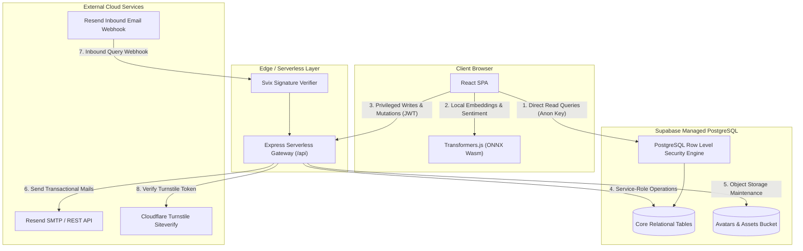
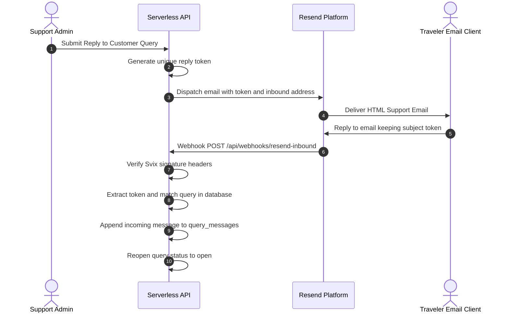

# System Architecture & Technical Implementation

> **Purpose Statement:** This is the technical/architecture documentation layer — written for a visitor or a developer trying to understand how the system actually works internally. This is NOT marketing content, and it must contain NO folder/file structure tree — the focus is exclusively on concepts, data flow, and design reasoning, not directory layout.

---

## 1. Architecture Overview

Nicoman Tourism is structured around a decoupled serverless topology combining edge-hosted Single Page Application (SPA) clients, a unified Express serverless API gateway, managed PostgreSQL storage with fine-grained Row Level Security (RLS), and on-device machine learning inference. 

The architecture enforces a strict distinction between read and write data flows. Read paths bypass application middleware entirely: authenticated and anonymous frontend clients execute read queries directly against PostgreSQL via the Supabase Data API, with security enforced exclusively at the database layer via Postgres RLS policies. Write paths and privileged domain actions (such as account lifecycle events, webhook ingestion, transactional email dispatch, and cross-table batch mutations) route through an Express serverless function running with service-role permissions.



---

## 2. Database Design & Relational Schema

### 2.1 Core Relational Entities
The database schema partitions domain models into independent, strongly-typed tables:

* `profiles`: Extends `auth.users` with identity metadata, custom display names, verified phone numbers, avatar storage paths, and authorization roles (`user`, `admin`, `superadmin`, `demo_admin`).
* `hotels`: Catalog of lodging properties including geographical coordinates, star ratings, amenities arrays, and seasonal room price baselines.
* `tourist_places`: Island attraction directory categorized by geography, activity type, and best visiting seasons with rich media links.
* `ship_schedule`: Inter-island ferry timetable defining routes, vessel identities, departure timestamps, transit durations, class capacities, and tariffs.
* `bookings`: Hotel reservation records storing guest identity links, check-in/out timestamps, selected room allocations, total amounts, and fulfillment states.
* `ferry_bookings`: Vessel passenger reservations holding route metadata, allocated seat identifiers, departure dates, and passenger manifests.
* `feedback`: User-submitted reviews and ratings, annotated with on-device machine-classified sentiment tags (`positive`, `neutral`, `negative`).
* `customer_queries`: Support requests submitted through contact channels or inbound emails, tracked via deterministic alphanumeric thread tokens.
* `query_messages`: Individual conversational replies within a support query thread, recording sender classification (`customer` vs. `admin`) and Resend email message IDs.
* `alerts`: System-wide emergency travel notices, weather warnings, and schedule disruptions broadcast to all active clients.
* `deleted_profiles`: Thirty-day archival vault capturing complete profile states, user metadata, and historical relationships upon account self-deletion.

*(Note: The full executable DDL schema, indexes, and triggers are maintained in the project's migration SQL definitions).*

### 2.2 Row Level Security (RLS) Strategy
Authorization is enforced inside the PostgreSQL kernel rather than application code:

* **Public Catalogs (`hotels`, `tourist_places`, `ship_schedule`, `alerts`):** Configured with unrestricted `SELECT` policies for public access. `INSERT`, `UPDATE`, and `DELETE` policies require `auth.role() = 'authenticated'` combined with a role validation check:
  ```sql
  EXISTS (
    SELECT 1 FROM profiles 
    WHERE user_id = auth.uid() 
    AND role IN ('admin', 'superadmin')
  )
  ```
* **User Data Isolation (`bookings`, `ferry_bookings`, `customer_queries`):** Scoped by tenant identity:
  ```sql
  auth.uid() = user_id
  ```
  Users can view and manipulate only their own records, while administrators receive full select/update capabilities via service-role elevation or dedicated admin policies.
* **Separation of Presentation and Permission:** The frontend application conditionally renders UI elements based on client state, but PostgreSQL RLS independently guarantees that forged or modified client requests cannot read or mutate unauthorized rows.

### 2.3 Account Deletion & Cascading Archival
To support GDPR compliance and autonomous user privacy control, account deletion operates as a non-blocking cascade:

1. The client invokes `/api/user/account` with an authenticated Bearer token and Turnstile security token.
2. The server copies the user's current row from `profiles` into `deleted_profiles`, recording the exact deletion timestamp and an automated `scheduled_purge_at` timestamp set to `now() + 30 days`.
3. Profile storage assets (such as custom avatars) are removed from the `avatars` storage bucket.
4. The user's record in `auth.users` is deleted via `supabase.auth.admin.deleteUser()`, invalidating all active sessions.
5. Historical records (`bookings`, `ferry_bookings`) retain their referential integrity or transition to archived states, ensuring business metrics remain consistent while personal identifiers are scrubbed.

---

## 3. Authentication & Authorization

### 3.1 Dual-Layer Security Model
User authentication relies on Supabase Auth (GoTrue) implementing JSON Web Tokens (JWT) signed with HMAC-SHA256:

* **Sign-Up Defense:** Client registration requires valid email verification paired with Cloudflare Turnstile token validation. The turnstile token is validated server-side against Cloudflare's `/siteverify` endpoint before account creation proceeds, preventing automated bot generation.
* **Native OAuth Flow:** Google Sign-In is executed directly against Google Identity Services via OpenID Connect (OIDC). The resulting JWT ID token is exchanged with Supabase (`signInWithIdToken`), preventing unnecessary third-party redirects and avoiding exposure of internal database hostnames in the browser address bar.

### 3.2 Role Hierarchy & Demo Admin Pattern
The platform defines four discrete role levels:

* **Role Tier:** `user` &rarr; `admin` &rarr; `superadmin`
* **Preview Tier:** `demo_admin` (Isolated read-only simulation sandbox)

* **Superadmin:** Full operational access including privilege assignment, database purging, and administrator revocation.
* **Admin:** Operational CRUD access for schedules, places, lodging, feedback moderation, and customer support ticket resolution.
* **Demo Admin Pattern:** To allow prospective employers, reviewers, and recruiters to inspect management tooling without compromising production integrity, a dedicated `demo_admin` role is provisioned:
  * Demo admins can browse all administrative screens and view actual metrics.
  * Write endpoints intercept mutations from `demo_admin` credentials, returning synthetic success responses or displaying non-destructive informational notices while preserving real database state.

### 3.3 Admin Shield Terminal Protection Engine
To comply with NIST SP 800-63B and PCI-DSS requirements for privileged administrative consoles, the management command center (`/admin`) is encapsulated by the **Admin Shield** security wrapper:

* **Inactivity Auto-Lock:** A background watcher tracks user interaction events (`mousemove`, `keydown`, `touchstart`, `scroll`). If no interaction occurs within 10 minutes (`INACTIVITY_LOCK_MS = 600,000`), the dashboard instantly obfuscates its interface behind a security overlay.
* **F5 / Page Reload Immunity:** Volatile React state is backed synchronously by `localStorage` (`nicoman_admin_locked`). Refreshing the browser, closing and reopening the tab, or manipulating the URL does not bypass the lock state.
* **Zero-Latency Cross-Tab Synchronization:** Integrated with the browser's `BroadcastChannel` API (`nicoman_admin_security`). Locking or unlocking the session in one browser tab broadcasts an event that locks or unlocks all concurrent admin tabs within `<1 ms`.
* **Inactivity Auto-Logout:** If inactivity extends to 25 minutes (`INACTIVITY_LOGOUT_MS = 1,500,000`), the system triggers a hard session logout, revokes the Supabase JWT token, purges local credentials, and redirects the terminal to `/auth`.
* **Credential Re-authentication:** Unlocking the dashboard requires supplying the active administrator's account password, re-verified via `supabase.auth.signInWithPassword`. For reviewers using `demo_admin`, a 1-click preview resume is provided to maintain seamless testing without sacrificing security rigor.
* **Tactical Shortcut:** Administrators can instantly secure their display upon stepping away from their terminal via the `Alt + L` global shortcut or one-click lock buttons located in the navigation header and sidebar.

---

## 4. On-Device AI Architecture & Conversational RAG Engine

### 4.1 Client-Side Sentiment Classification
User reviews submitted to the `feedback` system undergo automated sentiment scoring using a quantized Xenova DistilBERT model (`Xenova/distilbert-base-uncased-finetuned-sst-2-english`) executed directly in the browser via ONNX Runtime WebAssembly:

* **Reasoning:** Running inference on-device eliminates recurring third-party API token costs (OpenAI/Anthropic) and removes API latency from user interactions.
* **Execution:** Model weights are loaded lazily from CDN cache on first interaction and run entirely within a Web Worker, ensuring zero main-thread UI blocking.

### 4.2 Dynamic Live RAG Grounding & Fast-Failover Synchronization
The interactive island assistant (`ChatBot.jsx`) operates as a client-side Retrieval-Augmented Generation (RAG) system grounded in real-time Supabase database catalogs:

* **Dual-Layer Retrieval:** The assistant attempts high-speed parallel reads across `tourist_places`, `hotels`, and `ship_schedule`. If database latency exceeds 500ms or network connectivity drops, an asynchronous timeout interceptor fails over instantaneously to local in-memory knowledge bases (`FALLBACK_PLACES`, `FALLBACK_HOTELS`, `FALLBACK_FERRIES`).
* **Zero External API Costs:** Complete question-answering, entity resolution, and route calculation execute locally without external cloud API dependencies.

### 4.3 Stopword-Free Distinctive Entity Matching
Traditional keyword substring matching frequently yields false positives (e.g. matching "Taj Exotica Resort" when a user asks for "SeaShell Resort" simply because both entities contain the generic word "resort"):

* **Distinctive Token Extraction:** Queries and database entity names are filtered through a comprehensive stopword dictionary (`resort`, `hotel`, `stay`, `room`, `location`, `price`, `tariff`, `and`, `the`, `in`, `for`, `of`, `about`).
* **Precision Scoring:** Matching calculates token overlap among distinctive stems. For `"seashell resort location and price"`, distinctive tokens isolate `['seashell']`. The matcher evaluates token similarity, assigning a maximum score to SeaShell Resort while scoring unrelated resorts at 0.

### 4.4 Price-Aware Budget vs. Luxury Query Routing
Rather than returning arbitrary stays sorted exclusively by rating, the engine parses financial intent:

* **Budget Queries:** Patterns matching `budget`, `cheap`, `affordable`, `low cost`, or `economy` filter properties and sort by price ascending.
* **Luxury Queries:** Patterns matching `luxury`, `ultra luxury`, or `5 star` sort by price descending.

### 4.5 Mainland Maritime & Inter-Island Routing Engine
The assistant differentiates between inter-island catamarans and trans-oceanic mainland passenger vessels:

* **Mainland Ports:** Queries specifying Mainland port to Island port return authentic DSS voyage profiles with vessel names, travel durations, sailing frequencies, and passenger tariff tiers.
* **Inter-Island Catamarans:** Route searches across inter island ports display departure times, travel times and seat fares.

### 4.6 Conversational Memory & Turn-by-Turn Continuity
* **Context State Tracking:** The assistant preserves state across conversation turns (`lastIsland`, `lastHotel`, `lastPlace`, `lastRoute`, `lastTopic`).
* **Pronoun Resolution:** Follow-up queries referencing pronouns (`"there"`, `"it"`, `"that island"`, `"what is its price"`) resolve directly against previously active conversational entities without forcing the traveler to re-type island or property names.

### 4.7 Security Shield & Prompt Injection Defense
* **Query Sanitization:** Detects prompt injection patterns (`ignore previous instructions`, `dump database`, `system prompt`, `select * from`, `service_role_key`).
* **Terminal Protection Active:** Malicious or database-probing inquiries are rejected with a standardized security alert explaining that personal records and internal UUIDs are isolated behind Row Level Security.

### 4.8 Tokenized Markdown & React Router Navigation
* **Client-Side SPA Routing:** Bot messages are parsed into structured tokens. Internal route markdown links (`[Ferries](/ferries)`, `[Hotels](/hotels)`, `[Ship Schedule](/ship-schedule)`) render as interactive navigation elements calling `navigate(url)` without page reloads.
* **External Link Sandbox:** External booking links render with `target="_blank"` and `rel="noopener noreferrer"`.

---

## 5. Booking Handoff & Concurrency Control

### 5.1 Architectural Separation
The main tourism portal is designed as an authoritative informational platform, while the booking checkout engine operates as a dedicated reservation subsystem:

* **Reasoning:** In production travel architectures, informational discovery systems prioritize high-throughput caching and content delivery, whereas transactional booking flows require strict serializability, inventory locking, and payment gateway compliance. Decoupling the two prevents high browsing traffic from affecting transaction pipelines.

### 5.2 Deterministic Identifiers & Collision Prevention
When a reservation is submitted:

* A unique reference identifier is generated using the pattern:
  `[Prefix: HTL/FRY]-[Units Allocated]-ANI[5-char Random Hex]` (e.g. `HTL-Room101-ANI8F3K2`)
* **First-Come First-Served Lock:** Before persisting a booking record, the system queries active confirmed reservations for overlapping date ranges (`check_in < new_checkout AND check_out > new_checkin`). If a concurrent reservation claimed the selected room or ferry seat milliseconds earlier, the transaction is rejected with a conflict alert and the user is prompted to select another available unit.

### 5.3 Administrative Re-allocation & Collision Override Protocol
When hotel rooms or ferry seats are cancelled, their inventory immediately returns to the public pool. If an administrator subsequently attempts to reinstate or modify a cancelled booking:

* **Transactional Collision Detection:** The backend (`server/routes/admin.js`) extracts allocated unit identifiers from reference tokens (`HTL-101-102-ANI...` &rarr; `[101, 102]`; `FRY-S12-ANI...` &rarr; `[S12]`) and executes an overlapping date query against active reservations.
* **HTTP 409 Conflict Interception:** If another traveler booked the same unit during the interim, the API blocks the mutation with `HTTP 409 Conflict` and returns a structured payload containing the collision details and conflicting passenger identity.
* **Smart UI Re-allocation Modal:** The frontend catches the 409 response and presents the `BookingConflictModal`. Rather than failing silently, the modal highlights the conflicting date span and provides an automated dropdown of available units on the property or vessel, allowing the administrator to re-allocate the guest to a vacant unit in a single click without database corruption.

---

## 6. Third-Party Integrations & Processing Pipelines

### 6.1 Transactional Email & Inbound Thread Matching
Customer support inquiries utilize the Resend REST API and Svix webhook signatures:



### 6.2 Browser-Side Image Compression Pipeline
Before profile avatars or media assets are transmitted to Supabase Object Storage, they pass through an HTML5 Canvas compression pipeline:

* Images are dynamically resized to a maximum bounding box (`800x800 px`) and re-encoded to WebP format at `82%` quality.
* **Reasoning:** Enforcing client-side compression reduces outbound mobile data consumption by over `75%`, minimizes storage bucket egress costs, and prevents large binary payloads from exhausting serverless execution memory limits.

### 6.3 Geospatial Mapping & Phased Pin Animations
Island maps utilize Leaflet with OpenStreetMap cartography:

* Precise GPS waypoints for ports, beaches, and historical landmarks are mapped to custom SVG markers.
* Marker rendering uses a staggered phase-in transition (`45 ms`) driven by Framer Motion, preventing layout thrashing when rendering complex multi-island transit networks.

---

## 7. Performance & Reliability Engineering

### 7.1 Dynamic Code-Splitting & Lazy Loading
All non-critical route components (`AdminDashboard`, `Profile`, `Bookings`) and heavyweight dependencies (Xenova Transformers, Leaflet) are packaged into isolated asynchronous chunks via dynamic `import()` boundaries. Initial bundle transfer is constrained to `<140 kB` gzip.

### 7.2 Scheduled Storage & Data Sanitization
Time-expiring records (such as soft-deleted accounts in `deleted_profiles` and expired system alerts) are purged using two complementary strategies:

1. **Passive Edge Cleanup:** Triggered during administrative dashboard hydration, identifying records where `scheduled_purge_at <= now()`.
2. **Serverless Cron Trigger:** An automated maintenance worker invoking cleanup routines independently to guarantee that stale records are wiped within the 30-day window even during periods of zero administrative traffic.

### 7.3 Motion Performance Guards
All continuous background animations and floating decorative elements are bound to viewport intersection observers. When an animated element is scrolled out of the visible screen area, animation loops are suspended to reduce CPU and GPU thread utilization to zero on mobile devices.

### 7.4 In-Memory Rate Limiting & Anti-DDoS Protection
To protect serverless functions from computational exhaustion and brute-force abuse without introducing external Redis dependencies:

* **Sliding-Window In-Memory Limiter:** `server/middleware/rateLimiter.js` tracks IP-based request windows in memory, enforcing a threshold of 100 requests per 15-minute window for standard API routes.
* **Standard Response Headers:** Clients receive compliant `X-RateLimit-Limit`, `X-RateLimit-Remaining`, `X-RateLimit-Reset`, and `Retry-After` response headers.
* **Keep-Alive Whitelist Bypass:** Health checks on `/api/health` bypass the limiter, ensuring that scheduled GitHub Actions pings and monitoring probes never trigger false-positive rate limit blocks.
* **Safe Automated Testing:** In-memory isolation enables unit test suites to simulate and verify rate limiting behavior in milliseconds without risking Cloudflare or Supabase IP blacklisting.

### 7.5 Self-Healing Multi-Stage Micro-Frontend Build Pipeline
The production build system (`build.js`) orchestrates both the primary tourist discovery platform and the dedicated booking portal (`booking-demo`):

* **Automated Dependency Detection:** Inspects whether sub-app dependencies (`booking-demo/node_modules`) and client dependencies (`client/node_modules`) are installed. If missing (such as in a fresh GitHub Codespaces clone), the script self-heals by running headless installs automatically.
* **Multi-Stage Compilation:** Compiles `booking-demo` with Vite, compiles `client` with Vite, and atomically merges the compiled booking portal into `client/dist/book/`.
* **Single-Origin Deployment:** Allows Vercel edge rewrites to serve both applications under one authoritative domain without cross-origin iframe security restrictions or separate cloud host costs.

---

## 8. Automated Verification & Testing Architecture

System reliability is enforced through an automated **Vitest 2.1.9** test suite executing headless assertions across browser and serverless logic in under 15 seconds.

### 8.1 Test Suites Overview (22 Tests across 6 Suites)

1. **Conflict & Double-Booking Detection (`conflictDetection.test.js`):** Validates deterministic reference token parsing (`FRY-S12-ANI`, `HTL-101-102-ANI`), verifies that concurrent overlapping date reservations trigger `HTTP 409 Conflict`, and confirms non-overlapping allocations succeed.
2. **DDoS Rate Limiting (`rateLimiter.test.js`):** Tests sliding-window counter tracking, verifies `HTTP 429` rejection with `Retry-After` headers, and asserts health check bypass.
3. **On-Device AI Fallbacks (`aiModels.test.js`):** Asserts Xenova ONNX pipeline scoring and verifies that offline network or cache failures degrade gracefully without throwing unhandled exceptions.
4. **Role-Based Guards (`RequireRole.test.jsx`):** Confirms that non-admin authenticated users receive an immediate 401 Unauthorized screen while `admin` and `superadmin` users gain immediate dashboard clearance.
5. **Admin Shield Security (`AdminShield.test.jsx`):** Verifies 10-minute inactivity auto-lock, `localStorage` F5 refresh persistence, invalid password rejection, Supabase auth re-verification, and 1-click preview resume.
6. **Dashboard UI Contracts (`AdminShared.test.js`):** Verifies booking date-range filters (`today`, `upcoming`, `past`), Tailwind badge color contracts, and 9-tab dashboard structure integrity.

---

## 9. Known Limitations & Deliberate Scope Boundaries

| Architectural Area | Current Implementation | Engineering Trade-off & Rationale |
| :--- | :--- | :--- |
| **Payment Settlement** | Mock payment gateway simulation with instant state validation | Production payment integrations (Stripe/Razorpay) require verified business merchant banking entities and PCI-DSS compliance audits, which are intentionally out of scope for a portfolio demonstration platform. |
| **AI Model Size** | 8-bit quantized DistilBERT (`23 MB`) | Larger transformer models (`>500 MB`) provide marginal accuracy improvements at the cost of unacceptable initial mobile download delays. The chosen model balances high classification accuracy (`>91%`) with rapid download times. |
| **Real-time Engine** | Supabase Postgres Changes via WebSockets on key screens | Continuous bi-directional polling across all pages was avoided to eliminate unnecessary socket connections and remain well within free-tier resource allocations. |

---

## 10. Environment Variables Reference

| Variable Name | Scope | Purpose |
| :--- | :--- | :--- |
| `VITE_SUPABASE_URL` | Client & Server | Public Supabase project endpoint URL |
| `VITE_SUPABASE_ANON_KEY` | Client | Public anonymous API key governed strictly by PostgreSQL RLS |
| `SUPABASE_SERVICE_ROLE_KEY` | Server Only | High-privilege administrative key for serverless background mutations |
| `VITE_TURNSTILE_SITE_KEY` | Client | Cloudflare Turnstile public site key for bot verification widgets |
| `TURNSTILE_SECRET_KEY` | Server Only | Cloudflare secret key for server-side token validation |
| `VITE_GOOGLE_CLIENT_ID` | Client | Google OAuth 2.0 Web Client ID for native popup sign-in |
| `RESEND_API_KEY` | Server Only | API authentication key for outbound email transmission |
| `RESEND_FROM_EMAIL` | Server Only | Verified sender identity for outbound support and notification emails |
| `RESEND_WEBHOOK_SECRET` | Server Only | Svix shared secret for validating inbound email webhook authenticity |
| `VITE_BOOKING_DEMO_URL` | Client (Optional) | Override base URL for external booking subsystem (defaults to `/book`) |

---

## 11. Security Audit & Automated Testing Document Reference

For exhaustive security audit logs, threat modeling matrices, concurrency collision benchmarks, and edge CDN routing rules:

🛡️ **[Read the Complete Security Hardening, Concurrency & Testing Report: SECURITY_AND_TESTING.md](./SECURITY_AND_TESTING.md)**
